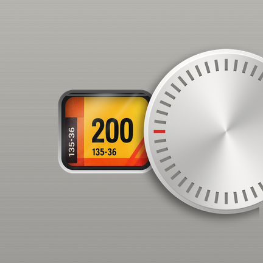

# 片刻 (pianke)



应用图标由 `tools/icon/render_icon.py` 按 Gold 200 标签图生成。

源码：<https://github.com/cheshuo233/PianKe>

片刻是一个 Android 胶片相机 App：
- 取景时，用 GPU 上的 LUT 加轻颗粒做实时预览；
- 按下快门后，由 C 写的冲洗引擎（`engine/`，经 NDK 编译）把照片冲洗成所选胶片的样子，存进 `DCIM/Pianke`。

胶片的色彩数据由 `tools/bake_films.py` 从 `films/films.toml` 烘焙而来。App 只申请 `CAMERA` 一项权限，不联网。

## 功能

- **15 卷胶片**：用拨盘换卷，或者点当前那卷打开弧形抽屉，单手拨选。换卷后取景立即换成这卷的色调。
- **变焦**：8 个等效焦段档位（18–200 mm），也可以切换成任意焦段。
- **点按对焦**：点哪里就在哪里对焦并测光，5 秒后恢复连续对焦。
- **计数**：每个镜头各装一卷 36 张。拍满时有倒片仪式，仪式感可以选关 / 中 / 高。
- **其他设置**：画幅 3:4 / 1:1、日期水印、网格线、颗粒强度、光晕、快门声与音量、震动。

## 原理

片刻的胶片色彩来自 [spektrafilm](https://github.com/andreavolpato/spektrafilm)（作者 Andrea Volpato，GPLv3）。

spektrafilm 是一个光谱级的胶片模拟器。它使用每种胶片的光谱感光度、特性曲线和染料密度，把「曝光 → 冲洗底片 → 印到相纸 → 扫描」这条链路完整地模拟一遍。片刻没有把它搬进手机，而是在电脑上把它的结果烘焙成查找表，手机只负责查表。

### 1. 烘焙（在电脑上，`tools/bake_films.py`）

- **配置**：每卷胶片在 `films/films.toml` 里指定 spektrafilm 的胶片配置和相纸配置：
  - 柯达彩色负片印到 Kodak Portra Endura 相纸；
  - 富士彩色负片印到 Fujifilm Crystal Archive Type II；
  - 电影负片印到 Kodak 2383 印片；
  - 反转片直接扫描，不经过相纸。
- **出表**：
  1. 取一个 33×33×33 的 sRGB 网格，解码成线性光；
  2. 送进 spektrafilm 的模拟管线。这一步关掉它自己的颗粒和光晕，只取色彩；
  3. 再编码回 sRGB。

  每卷由此得到一张 3D LUT。
- **打包**：15 卷的 LUT 和颗粒、光晕参数一起写进 `films.bin`；界面上用的名字、ISO、工艺写进 `films.json`。spektrafilm 锁定在一个固定的 commit 上，所以烘焙结果可以复现。
- **核对**：`tests/bake` 用灰阶和 ColorChecker 色块，把查表结果与 spektrafilm 直接渲染的结果对比。要求平均 ΔE2000 ≤ 1、最大 ≤ 3。

### 2. 取景（在手机 GPU 上）

CameraX 的预览帧送进一个 OpenGL ES 3.0 着色器，依次经过：相机纹理 → 当前胶片的 3D LUT → 一层轻颗粒。

取景和成片用的是同一份 LUT 字节，所以取景里看到的色调，就是冲出来的色调。

### 3. 冲洗（在手机 CPU 上，`engine/`，C11）

按下快门后，原片先落盘到 `pending/`，再由后台按下面的顺序冲洗：
1. 解码，按 EXIF 转正；1:1 画幅时取中心正方形。
2. 光晕：亮部（亮度 ≥ 0.8）向周围渗出一圈带颜色的光。
3. 3D LUT，四面体插值。
4. 颗粒：叠加在亮度上的单色噪声，中间调最强，暗部和亮部减弱。
5. 日期水印。
6. 存成 JPEG，写入 `DCIM/Pianke`，并拷贝原片的 EXIF。

如果冲洗途中 App 被杀掉，下次启动会从 `pending/` 接着冲。

拍摄时，相机一侧关掉了锐化，并把降噪调到最低。这样交给胶片模拟的信号尽量干净。

### 现在的局限

- 光晕和颗粒是片刻自己的近似算法，参数在 `films.toml` 里按观感调整，不是 spektrafilm 的物理模型。
- 每卷只有一张 LUT，处理的是 8 位 sRGB 的 JPEG，不走 RAW。

## 构建前提

- Android Studio，SDK Manager 里装 SDK 37 平台、NDK 30.0.16248370、CMake 4.1.2；`local.properties` 里有 `sdk.dir`。
- 宿主机测试：MSVC 2022 Build Tools，以及 `tools/.venv`（Python 3.13，按 `tools/requirements.txt` 安装）。

## 构建与安装

```
.\gradlew.bat :app:assembleDebug
.\gradlew.bat :app:installDebug
```

JDK 17 及以上；用 Android Studio 自带的 `jbr` 即可。

## 烘焙胶片

改了 `films/films.toml` 或 `tools/` 之后重新烘焙：

```
tools\.venv\Scripts\python.exe tools/bake_films.py --toml films/films.toml --out app/src/main/assets/films.bin --json app/src/main/assets/films.json
```

## 闸口与钩子

```
pwsh -NoProfile -File scripts\check.ps1
pwsh -NoProfile -File scripts\install-hooks.ps1
```

`check.ps1` 按规格 §11.6 依次跑各项检查，第一个失败即以非 0 退出（包括 `tools/.venv` 或 `gradlew.bat` 缺失），成功时最后一行是 `check passed`。JAVA_HOME 未设置时取注册表里 Android Studio 的 `jbr`。`install-hooks.ps1` 把它装成 `.git/hooks/pre-push`，重复运行无害。

## 插桩测试（HyperOS）

HyperOS 拒绝 `install -g`（INSTALL_GRANT_RUNTIME_PERMISSIONS），所以 `connectedDebugAndroidTest` 会跑出 0 个测试。改用：

1. `adb install -r -t` 分别装 app 和 test 两个 APK，在手机上确认每次安装提示；
2. `adb shell am instrument -w -r app.pianke.test/androidx.test.runner.AndroidJUnitRunner`。

## 真机清单

每次发布前按 [docs/device-checklist.md](docs/device-checklist.md) 在真机上逐条跑，结果记在该文件末尾的表里。

## 协议与致谢

- 代码：GPL-3.0，见 `LICENSE`。
- 字体：Share Tech Mono、IBM Plex Mono，均为 OFL，协议文本在 `app/src/main/assets/licenses/`。
- 音效：原创合成，来源见 `tools/SOUND_SOURCES.md`。
- 胶片模拟数据来自 [spektrafilm](https://github.com/andreavolpato/spektrafilm)，感谢其作者。

胶片名称仅用于说明所模拟的胶片，商标归各自所有者。
